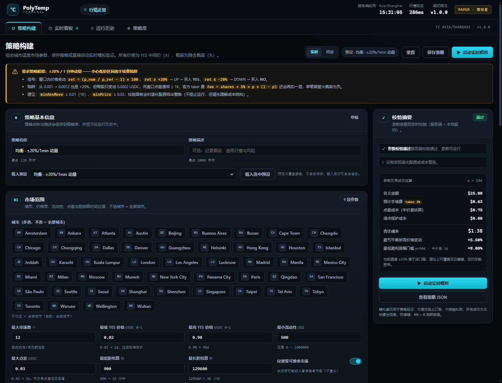
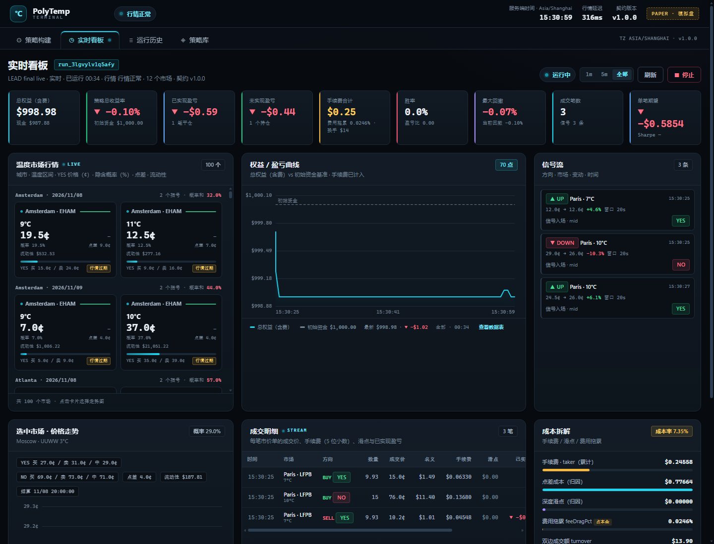

# Polymarket Weather Strategy Lab · 温度策略验证系统

> 面向 [Polymarket](https://polymarket.com) **城市最高温度市场** 的策略验证系统。
> 用官方实时行情做 **paper trading（模拟市价交易）**，验证「短线频繁市价交易」类策略——
> 例如「1 分钟内价格上涨 20% 就立即买入 UP，下跌 20% 立即买入 DOWN」——到底行不行。

**零依赖 · 零构建 · 一键启动 · 全链路可验证**

```bash
node server/index.js
# 浏览器打开 http://127.0.0.1:8787
```

---

## 目录

- [功能特性](#功能特性)
- [快速开始](#快速开始)
- [策略参数](#策略参数)
- [费用模型（官方）](#费用模型官方)
- [系统架构](#系统架构)
- [项目结构](#项目结构)
- [测试与验证](#测试与验证)
- [设计文档](#设计文档)
- [免责声明](#免责声明)

---

## 界面预览

**策略构建器**：市场域 / 信号 / 执行 / 退出 / 风控 / 费用 / 仿真 全参数组合，实时校验并给出退化配置警告。



**实时看板**：真实温度市场行情网格（按城市/日期分组、隐含概率与概率和校验）、权益曲线、信号流、成交明细（含 5 位小数手续费）、持仓、成本拆解。



---

## 功能特性

| 模块 | 能力 |
|---|---|
| **实时行情** | 官方 Gamma API 发现城市温度事件（每个城市每天 11 个 °C/°F 括号市场），CLOB API 获取盘口/中间价/成交；WebSocket 多连接按约 20 个城市分批订阅 + REST 轮询自动降级 |
| **策略构建器** | 市场域（城市/价格带/流动性/点差/距结算时间）、信号（窗口/阈值/最小绝对变动/确认/冷却）、执行（仓位/上限/滑点）、退出（止盈/止损/超时/持有到结算）、风控（资金/回撤/日亏熔断）、费用、仿真 参数全可视化组合 |
| **实时模拟交易** | 市价单逐档吃单（VWAP）、部分成交、最小下单量（买入 $1 名义额、卖出无股数下限）、滑点保护；**官方 taker 手续费逐笔计入成本** |
| **实时看板** | 权益曲线、总收益、已实现/浮动盈亏、胜率、盈亏比、夏普、最大回撤、费用拖累、隐含概率、成交明细、持仓、信号流、行情网格 |
| **双模式** | `live` 实时模拟（官方实时行情）+ `replay` 历史回放（Data API 分钟级价格，用于复现与无行情时验证） |
| **运行历史** | 运行列表、单次详情、两次运行指标对比 |
| **策略库** | 策略保存/加载/删除，内置保守/均衡/激进三档预设 |
| **工程质量** | Node 22 标准库、零 npm 依赖；ES Modules 原生前端、无打包；`node:test` 单元/集成/API 一致性测试 |

## 快速开始

### 环境要求
- Node.js **22+**（使用内置 `fetch` / `WebSocket` / `node:test`）
- 可访问 `gamma-api.polymarket.com`、`clob.polymarket.com`、`data-api.polymarket.com`
- 无需安装任何 npm 依赖

### 启动
```bash
# 1. 克隆/进入项目目录
cd polymarket-weather-strategy-lab

# 2. 启动（默认 127.0.0.1:8787）
node server/index.js

# 3. 打开浏览器
#    http://127.0.0.1:8787
```

可选环境变量：

| 变量 | 默认 | 说明 |
|---|---|---|
| `PORT` | `8787` | 服务端口 |
| `HOST` | `127.0.0.1` | 仅本机监听（安全默认） |
| `FEED_MODE` | `auto` | `auto` / `ws` / `poll` 行情通道 |
| `POLL_MS` | `1000` | 轮询间隔（毫秒） |
| `WS_CITIES_PER_CONNECTION` | `20` | 每个 CLOB WebSocket 连接约覆盖的城市数（多连接分批订阅） |
| `DATA_DIR` | `./data` | 策略与运行记录持久化目录 |

### 使用流程
1. 打开 **策略构建**，选择预设（或自定义参数）→ 自动校验。
2. 点击 **启动实时模拟**（也可切换 `replay` 回放模式）。
3. 跳到 **实时看板**，观察行情、信号、成交、持仓、盈亏与费用。
4. 在 **运行历史** 中回看/对比，在 **策略库** 中保存或复用策略。

## 策略参数

> 完整语义见 [docs/03-strategy-spec.md](docs/03-strategy-spec.md)，参数分类学见 [docs/02-strategy-parameters.md](docs/02-strategy-parameters.md)。

| 组 | 关键参数 |
|---|---|
| 市场域 `universe` | `cities[]`、`minPrice`/`maxPrice`、`minLiquidityUsd`、`maxSpread`（下单时校验）、`minTimeToResolutionSec`/`maxTimeToResolutionSec`；只做当天市场，UTC 00:00 自动滚动 |
| 信号 `signal` | `priceField`(mid/last/best_bid/best_ask)、`windowSec`、`moveThresholdPct`、`minAbsMove`、`direction`(up/down/both)、`confirmationTicks`、`cooldownSec`、`maxSignalsPerMarket` |
| 执行 `execution` | `sizingMode`(fixed_stake/pct_equity)、`sizingValue`、`maxPositionUsd`、`maxPositions`、`maxPositionsPerMarket`、`slippageBufferBps` |
| 退出 `exit` | `takeProfitPct`、`stopLossPct`、`maxHoldSec`、`holdToResolution`、`exitOnOppositeSignal` |
| 风控 `risk` | `bankrollUsd`、`maxDrawdownPct`、`dailyLossLimitUsd`、`killSwitch` |
| 费用 `fees` | `model=weather_taker`、`takerFeeRate=0.05` |
| 仿真 `sim` | `mode`(live/replay)、`tickIntervalMs`、`replayLookbackMin`、`speed` |

**核心示例（需求原文）**：`priceField=mid, windowSec=60, moveThresholdPct=20, minAbsMove=0.01, direction=both` —— 1 分钟上涨 ≥20% 且绝对变动 ≥1¢ 时买入 YES（UP），下跌对称买入 NO（DOWN）。

> ⚠️ 低价区间陷阱：在 0.001–0.01 的括号上，1 个 tick 就可能是 +100%，而点差和手续费会吃掉绝大部分“收益”。系统强制 `p_ref ≥ 0.01` 护栏，并在策略校验时给出退化警告（详见 docs/03 §2.5、docs/04 §5.10）。

## 费用模型（官方）

Polymarket **Weather 类市场 taker 费率 0.05，maker 免费，maker 返佣 25%**（以市场 `feeSchedule` 字段为准）：

```text
fee = shares × 0.05 × p × (1 − p)     # p = 成交价（VWAP）
四舍五入到 5 位小数；< 0.00001 记为 0
```

100 股示例：p=0.05 → $0.2375；p=0.30 → $1.05；p=0.50 → $1.25；p=0.70 → $1.05；p=0.95 → $0.2375。
买入时 `cash -= notional + fee`，卖出时 `cash += notional - fee`，结算兑付不收费。系统同时归因 **点差成本** 与 **订单簿滑点**，看板展示含费后的真实盈亏。

## 系统架构

```
浏览器（原生 ES Modules + Canvas，无构建）
   │  REST /api/*  +  SSE /api/stream
   ▼
Node 22 HTTP Server（零依赖）
   ├─ api.js / sse.js / store.js
   ├─ engine/  signal · execution · portfolio · metrics · run
   └─ data/    gamma（发现）· clob（盘口）· feed（WS+轮询）· replay（回放）
          │
          ▼
官方公开只读 API：gamma-api / clob / data-api
```

- **实时模拟**：tick 驱动（默认 1s）→ 滚动窗口信号 → 风控 → 逐档市价单 → 官方费用 → 账本/指标 → SSE 推送。
- **回放模式**：Data API v2 分钟级价格（`bucket_seconds=60`）按倍速回放，复用同一引擎。
- **安全边界**：仅本机监听、只读公开 API、不接私钥、不提交真实订单。

详见 [docs/06-architecture.md](docs/06-architecture.md) 与 [docs/07-api-contract.md](docs/07-api-contract.md)。

## 项目结构

```
├── server/            # Node 22 后端（零依赖）
│   ├── data/          # Gamma 发现、CLOB 盘口、实时/回放数据源
│   └── engine/        # 信号、执行、账本、指标、运行生命周期
├── web/               # 零构建前端（原生 ES Modules + Canvas）
├── shared/contract.js # 前后端共享契约（默认值/校验/费率/预设）
├── docs/              # 需求分析、API 研究、策略/产品/UI/架构/接口文档
├── design/prototype/  # UI 高保真静态原型
├── tests/             # node:test 单元/集成/API 一致性测试
└── scripts/           # 启动与真实 API 冒烟验证脚本
```

## 测试与验证

```bash
npm test                  # node:test 单元 + 集成 + API 一致性测试
node scripts/verify.js    # 真实 PolyMarket API 冒烟验证（健康检查/实时市场/回放运行/费用校验）
node scripts/browser-check.mjs  # 前端静态检查 + headless 渲染冒烟
```

**实测结果（2026-11-08，本机 Node 22.22.1）**

| 检查 | 结果 |
|---|---|
| `npm test` | **83 / 83 通过**（contract 15、validation 15、engine 35、integration 6、api-conformance 11、persistence 1） |
| `node scripts/verify.js`（真实 API） | **PASS 14 / 14**：100 个实时温度市场、37 个城市、98 个事件；真实回放交易手续费逐笔校验；停止/权益恒等式通过 |
| `node scripts/browser-check.mjs` | **PASS 11 / 11**：8 个前端模块解析、静态资源 MIME、headless Edge 1440×1000 渲染策略构建页与看板（无 JS 异常） |

> 详细报告：[tests/QA-REPORT.md](tests/QA-REPORT.md)（验收覆盖矩阵、6 个已修复缺陷、已知限制）。

测试覆盖：官方费率精度与舍入、滚动窗口信号、逐档成交 VWAP/部分成交、账本与盈亏恒等式、指标（胜率/盈亏比/夏普/回撤）、策略校验、API 契约、SSE 事件流。

## 设计文档

| 文档 | 内容 |
|---|---|
| [docs/02-strategy-parameters.md](docs/02-strategy-parameters.md) | 温度市场可量化参数分类学（策略专家） |
| [docs/03-strategy-spec.md](docs/03-strategy-spec.md) | StrategyConfig / 信号 / 执行 / 退出 / 风控语义（策略专家） |
| [docs/04-product-spec.md](docs/04-product-spec.md) | 费用模型、成本核算、P&L 指标与验收标准（产品） |
| [docs/05-ui-spec.md](docs/05-ui-spec.md) | UI/UX 设计规范（设计） |
| [docs/06-architecture.md](docs/06-architecture.md) | 系统架构 |
| [docs/07-api-contract.md](docs/07-api-contract.md) | 前后端接口契约 |
| [research/](research/) | 官方 API 研究、样例与探测脚本 |
| [research/api-research.md](research/api-research.md) | 官方 API 集成研究报告（878 行，全部端点实测） |

## 免责声明

本项目仅用于**策略研究与教学**，所有交易均为模拟，不接入真实资金、不构成任何投资建议。预测市场交易存在风险，请遵守当地法律法规与平台条款。
